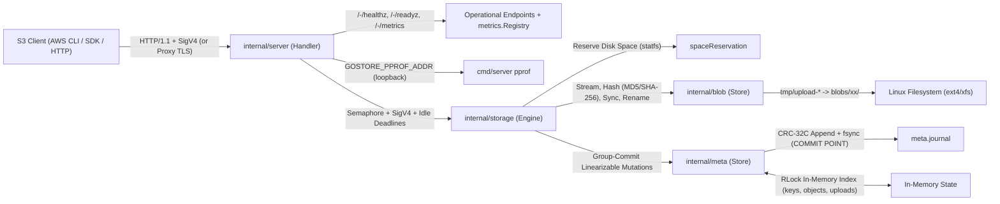

# GoStore Architecture

GoStore is a single-node, S3-compatible object storage service written in Go for Linux (`amd64`/`arm64`). It separates streaming blob I/O from serialized metadata commits so large uploads and downloads run concurrently without holding metadata locks or database transactions across network I/O.

## Component Architecture



## Write Protocol & Commit Point

Every `PutObject` and `UploadPart` streams outside metadata locks and becomes visible only when its metadata journal record commits and syncs:

```text
Client Body
   │
   ▼  (stream via 64 KiB buffer; compute Size, MD5, SHA-256; check Content-MD5/SHA-256/chunk sigs)
1. Write to <data>/tmp/upload-*
   │
   ▼
2. Verify Content-Length, Content-MD5, X-Amz-Content-Sha256, chunked trailers
   │  (on failure: unlink temp file, return error)
   ▼
3. f.Sync() + f.Close()
   │
   ▼
4. os.Rename(tmp, <data>/blobs/<id[:2]>/<id>) + syncDir(<data>/blobs/<id[:2]>)
   │  (blob is immutable on disk, not yet visible in metadata)
   ▼
5. meta.Store.submit() ──► group-commit queue ──► journal.Write(batch) + journal.Sync()   ◀── COMMIT POINT
   │                                                      │
   │  (if crash before Sync completes: old object stays visible; unreferenced blob removed on startup)
   ▼  (on Sync success: apply under meta.mu.Lock(); new object is immediately visible to readers)
6. Return 200 OK + ETag, then best-effort delete replaced blob
```

Multipart completion (`CompleteMultipartUpload`) follows the same protocol: active part blobs are pinned (`blobPins`), assembled sequentially into a new immutable blob and synced (`steps 1–4`), and then published atomically in one `opCompleteUpload` journal record (`step 5`) before unpinning and deleting obsolete part/replaced blobs (`step 6`).

## Read Path & Integrity Verification

1. `Engine.OpenObject` looks up `(bucket, key)` under `meta.mu.RLock()`, opens `<data>/blobs/<id[:2]>/<id>`, and checks its file size matches metadata. If a concurrent overwrite/delete unlinked the blob between metadata lookup and `open(2)`, `lookupObject` retries `meta.Object` against the updated metadata; once opened on Linux, an unlinked file remains readable until closed.
2. **Full-object `GET`**: [`streamVerified`](../internal/server/s3.go) streams chunks while updating SHA-256 and **holds back the final chunk** until EOF. Only after verifying exact byte length and `SHA-256 == obj.SHA256` does it send the final chunk. If verification fails mid-stream after headers were sent, GoStore logs the corruption, records `InternalError`, and hijacks/closes the TCP socket so the client sees an incomplete read instead of silent corruption.
3. **Range `GET` (`206 Partial Content`)**: Seeks to the requested byte offset and streams the range via `io.CopyN` without full-object SHA-256 verification.

## Concurrency, Limits, and Graceful Shutdown

- **Data request concurrency:** Bounded by a non-blocking semaphore (`GOSTORE_MAX_CONCURRENT_REQUESTS`, default `256`); excess requests immediately receive `503 SlowDown` with `Retry-After: 1`. `/-/healthz`, `/-/readyz`, and `/-/metrics` bypass the semaphore.
- **Metadata group commit:** Concurrent writers share one journal `Sync()` per queued batch while preserving strict pre-return durability and conflict ordering (see [ADR 0001](adr/0001-concurrency-and-resource-limits.md) and [ADR 0002](adr/0002-metadata-group-commit.md)).
- **Disk accounting:** Known-size uploads and multipart assemblies reserve headroom (`avail - reserved - GOSTORE_MIN_FREE_SPACE`); unknown-size streams check dynamically per write chunk, and `ENOSPC` cleans up uncommitted temp files without disturbing committed objects.
- **Shutdown:** On `SIGINT`/`SIGTERM`, `/-/readyz` immediately flips to `503 not ready`, `http.Server.Shutdown` drains active requests up to `GOSTORE_SHUTDOWN_TIMEOUT`, cancels contexts if exceeded, waits for workers (`expiryWorker`, handlers), and closes `meta.journal` and the directory `flock`.

## Startup Recovery

On startup (`storage.OpenWithOptions`), before listening:

1. Take an exclusive non-blocking `flock` on the data root (`ErrLocked` if another server owns it) and ensure `tmp/` and all 256 `blobs/00..ff` shard directories exist and are synced.
2. Replay `meta.journal` (refuses startup on corrupt mid-file records or missing journal when blobs exist; discards incomplete/zeroed tail records and truncates/syncs the journal). Compact the journal atomically if `records > 2*live + 1000`.
3. Remove any leftover files in `tmp/`, verify every metadata object's blob exists with matching size (recording any mismatch in `Report.Damaged`), and delete unreferenced orphan blobs.
