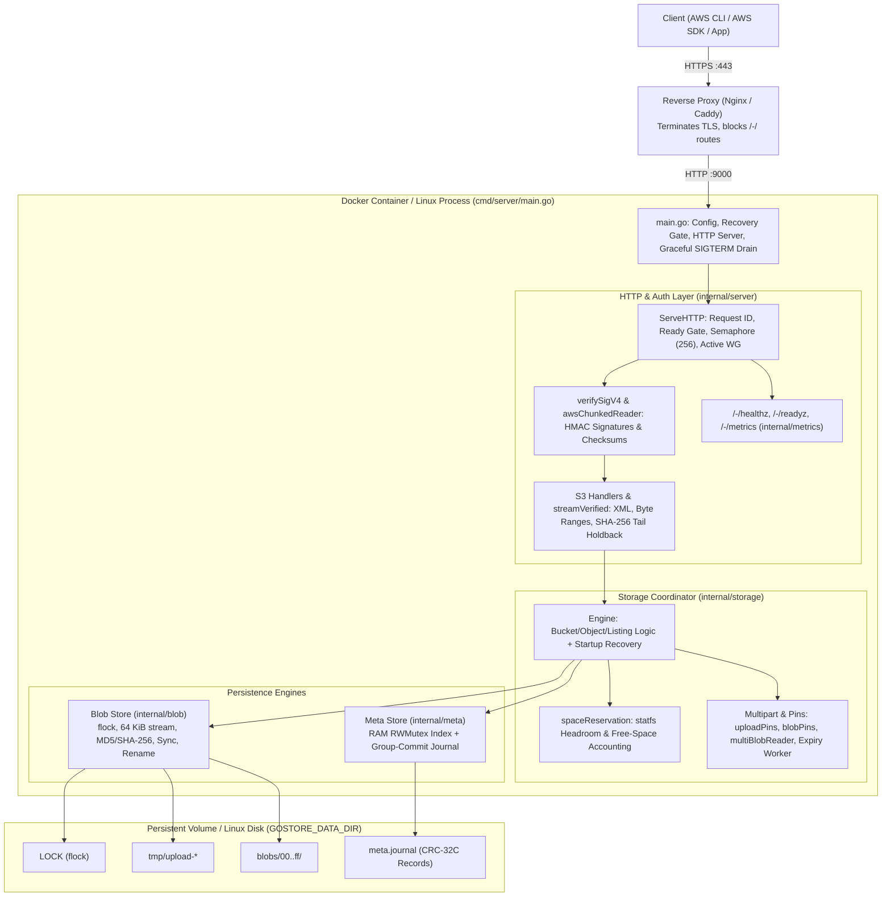
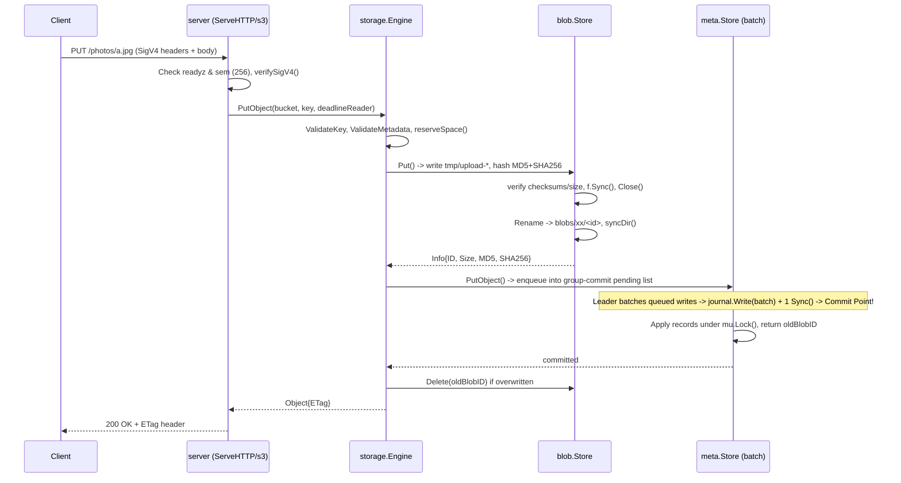
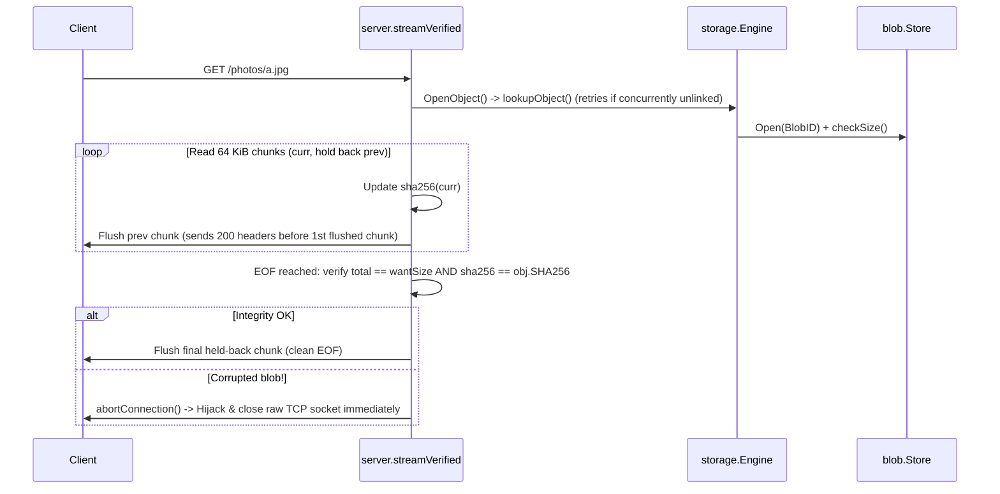

# GoStore Explained From Scratch: Concepts, Architecture & Code Guide

Welcome! Whether you are new to Go, backend storage, S3, or Docker, this guide explains **what GoStore does**, **why each piece exists**, **what every technical term means**, and **how the production code works file by file** (with exact code references and real snippets).

---

## Table of Contents

1. [What Does GoStore Do? (60-Second Analogy)](#1-what-does-gostore-do-60-second-analogy)
2. [Why Each Component Exists](#2-why-each-component-exists)
3. [Plain-English Glossary of Technical Terms](#3-plain-english-glossary-of-technical-terms)
4. [System Architecture Diagram](#4-system-architecture-diagram)
5. [How Core Workflows Run (Visual Flows)](#5-how-core-workflows-run-visual-flows)
6. [Recommended Code Reading Order & Defaults Cheat Sheet](#6-recommended-code-reading-order--defaults-cheat-sheet)
7. [Detailed Code Walkthrough (Package by Package)](#7-detailed-code-walkthrough-package-by-package)

---

## 1. What Does GoStore Do? (60-Second Analogy)

**GoStore is a self-hosted, S3-compatible file/object storage server written in Go for Linux.**

Applications (websites, backup tools, the AWS CLI, or Go/Python SDKs) use the **Amazon S3 HTTP API** to upload, list, download, and delete files over the network. Instead of paying AWS S3, you can point those exact same tools at `http://127.0.0.1:9000` (or your server's URL), and GoStore handles the requests and stores the data on your own disk.

### The "Coat-Check" Analogy

Think of GoStore like a strict hotel coat check:

1. You bring a jacket (**file bytes**) and say, *"Store this under `photos/2026/beach.jpg`"* (**bucket + key**).
2. The attendant checks your ID card (**SigV4 authentication**) and makes sure there is locker space left (**disk free-space reservation**).
3. They put your jacket in an empty numbered locker **`#4f9a...`** (**a random immutable blob file**) and lock the locker (**`fsync` + directory sync**).
4. Next, they write one line in the front-desk ledger (**`meta.journal`**): *"`photos/2026/beach.jpg` is in locker `#4f9a...`"* and save the ledger (**`journal.Sync()`**).
5. Only **after** the ledger is saved do they hand you a receipt (**`HTTP 200 OK` + `ETag`**).
6. If the power flickers at step 3 (before the ledger is updated), on restart the attendant walks the room, sees jacket `#4f9a...` isn't listed in the ledger, and throws it away cleanly without corrupting your earlier `beach.jpg`!

### Regular Computer Folder vs. S3 Object Storage

| Regular Computer Folder | S3 Object Storage (GoStore) |
|---|---|
| Files live at real folder paths (`D:\photos\2026\a.jpg`) | You create top-level **Buckets** (`photos`) and save **Objects** by **Key** (`2026/a.jpg`) |
| Dangerous filenames like `../../etc/passwd` can escape folders if joined into paths | Object keys are **only text in metadata**—on disk, files always use safe random hex IDs (`blobs/4f/4f9a...`) |
| Overwriting a file modifies bytes in place (crash = half-new, half-old garbage) | Every upload writes a **brand-new file**, swaps the metadata pointer atomically, and deletes the old file afterward |

---

## 2. Why Each Component Exists

Before reading code, it helps to know *why* each technology appears in this project:

- **Why S3 (instead of inventing a custom HTTP upload API)?**
  Thousands of existing tools (`aws` CLI, `aws-sdk-go-v2`, `boto3`, Terraform, backup tools) already speak S3 out of the box. Speaking S3 means existing clients work with zero custom client code.
- **Why AWS Signature V4 (instead of a simple password header)?**
  Sending your secret password on every HTTP request leaks it in logs or plaintext connections. With **SigV4**, the client uses your `GOSTORE_SECRET_KEY` locally to compute a mathematical fingerprint (**HMAC-SHA256**) of the method, path, headers, timestamp, and payload. GoStore runs the exact same math using its copy of `GOSTORE_SECRET_KEY` and compares the two signatures. Even if someone intercepts a request, they can't modify the URL or replay it past the 15-minute window.
- **Why Docker & Docker Compose?**
  GoStore relies on Linux filesystem behavior (`flock`, `statfs`, `fsync`, POSIX `rename`). **Docker** packages GoStore cleanly inside a tiny Alpine Linux container running as a non-root user (`UID 10001`), while **Docker Compose** (`docker-compose.yml`) starts the server with one command and attaches a persistent **Volume** (`gostore_data`) so your files stay safe even if you delete/rebuild the container.
- **Why a Reverse Proxy (Nginx or Caddy)?**
  GoStore itself serves fast plain `HTTP` on localhost (`127.0.0.1:9000`). In production, Nginx or Caddy sits in front on port `443`, handles **HTTPS/TLS encryption**, blocks external callers from accessing internal endpoints (`/-/metrics`, `/-/healthz`), and forwards clean HTTP to GoStore.
- **Why keep Metadata in RAM + `meta.journal` (instead of reading folders on every request)?**
  Listing objects by prefix (`photos/2026/`) in RAM using a sorted list + binary search takes microseconds, while appending every change to `meta.journal` with `Sync()` guarantees crashes don't lose committed objects.
- **Why Group Commit?**
  Calling Linux `fsync` to flush to physical disk takes ~2–8 milliseconds. If 32 users upload files at the exact same moment and wait one-by-one (`32 × 4ms = 128ms`), the server stalls. **Group Commit** works like a shuttle bus: everyone who finishes writing their blob while an earlier journal `Sync()` is running waits in one queue, and the next trip flushes **all** waiting metadata records in **one** `Write` + **one** `Sync()`.

---

## 3. Plain-English Glossary of Technical Terms

### S3 & HTTP Concepts
| Term | Plain-English Meaning |
|---|---|
| **Bucket** | Top-level namespace/container for objects (e.g., `photos`). Names must be 3–63 chars, lowercase/digits/`-`/`.`. |
| **Key** | Object name inside a bucket (`2026/jan/pic.jpg`). Up to 1,024 UTF-8 bytes, no NUL bytes. |
| **Path-style URL** | URL format `http://host/{bucket}/{key}` (unlike virtual-hosted `http://{bucket}.host/{key}`). |
| **ETag** | Quoted fingerprint of an object's bytes (`"d41d8cd98f00b204e9800998ecf8427e"`). Single uploads use MD5; multipart uploads use `<md5-of-part-md5s>-<partCount>`. |
| **Prefix & Delimiter** | Query options in `ListObjectsV2`: `prefix=2026/` filters keys starting with `2026/`; `delimiter=/` groups nested keys into folder-like `CommonPrefixes` (e.g., `2026/jan/`). |
| **Continuation Token** | An opaque bookmark returned when a listing exceeds `max-keys` so the client can ask for page 2. |
| **Byte Range (`Range`)** | Downloading only part of an object (`bytes=0-1023`, `bytes=500-`, or suffix `bytes=-100`), returning `HTTP 206 Partial Content`. |
| **Multipart Upload** | Uploading a large file in separate parts (`CreateMultipartUpload` -> `UploadPart` × N -> `CompleteMultipartUpload`), or canceling (`AbortMultipartUpload`). |
| **XML** | Tag-based response format (`<ListBucketResult>...</ListBucketResult>`) expected by S3 clients. |

### Security & Authentication
| Term | Plain-English Meaning |
|---|---|
| **AWS SigV4** | Request-signing scheme using `Authorization: AWS4-HMAC-SHA256 Credential=..., SignedHeaders=..., Signature=...`. |
| **HMAC-SHA256** | Keyed cryptographic hash combining a secret key and message bytes. |
| **Constant-Time Compare** | Checking two byte slices (`hmac.Equal`, `subtle.ConstantTimeCompare`) in fixed time regardless of which byte differs, blocking timing side-channel attacks. |
| **`aws-chunked`** | Streaming upload encoding where AWS CLI/SDK wraps chunks with optional per-chunk HMAC signatures and trailing checksums (`CRC32`, `CRC32C`, `SHA1`, `SHA256`, `CRC64NVME`). |
| **Loopback (`127.0.0.1` / `::1`)** | Network interface reachable *only* from the same machine (`localhost`), never from the outside network. |

### Storage & Linux Durability
| Term | Plain-English Meaning |
|---|---|
| **Blob** | Raw immutable file bytes stored under `blobs/<first-2-hex>/<32-char-id>`. |
| **`fsync` (`f.Sync()`)** | OS call forcing dirty file bytes from kernel RAM buffer onto non-volatile disk. |
| **Directory Sync (`syncDir`)** | Calling `fsync` on a folder FD so a newly renamed filename itself survives power loss. |
| **Atomic `Rename`** | POSIX `os.Rename` swaps a file into place in one indivisible step. |
| **Advisory Lock (`flock`)** | Kernel lock on `LOCK` so two GoStore instances cannot run on the same `data/` folder simultaneously. |
| **Shard Directories** | Pre-created `blobs/00` through `blobs/ff` (256 folders) so millions of files aren't stuffed into one giant directory and uploads never need `mkdir`. |
| **CRC-32C (Castagnoli)** | Fast 32-bit checksum protecting both record length and JSON payload in `meta.journal` from bit rot or torn writes. |

### Concurrency, Operations & Docker
| Term | Plain-English Meaning |
|---|---|
| **Goroutine** | Lightweight Go worker thread managed by Go's scheduler. |
| **Mutex / `RWMutex`** | Mutual exclusion locks: `Mutex` allows 1 goroutine; `RWMutex` allows many simultaneous readers (`RLock`) OR 1 writer (`Lock`). |
| **Semaphore (`sem`)** | Buffered channel (`chan struct{}`) limiting simultaneous S3 requests to `256` by default; overflow returns `HTTP 503 SlowDown`. |
| **Pins (`uploadPins` / `blobPins`)** | Reference counters preventing background expiry or deletes from deleting an upload/part file while another goroutine is actively assembling or reading it. |
| **`/-/healthz` vs `/-/readyz`** | `healthz` reports `"ok"` if alive; `readyz` returns `"ready"` (`200`) while serving and flips to `"not ready"` (`503`) the instant shutdown starts. |
| **Graceful Shutdown (`SIGTERM`)** | Catching stop signals, turning unready, letting in-flight transfers finish up to `30s`, canceling leftovers, and closing disk handles cleanly. |
| **Prometheus Metrics (`/-/metrics`)** | Numeric counters, gauges, and latency buckets (`gostore_*`) scraped by monitoring tools. |
| **Multi-Stage `Dockerfile`** | Builds the Go binary in a fat SDK image (`golang:1.27-alpine`), then copies just the binary into a tiny runtime image (`alpine:3.21`). |

---

## 4. System Architecture Diagram



---

## 5. How Core Workflows Run (Visual Flows)

### 5.1 Upload (`PutObject`) & Group Commit



### 5.2 Download (`GetObject`) & SHA-256 Integrity Protection

Why doesn't GoStore stream the entire file straight to the socket blindly? Because if a disk sector silently corrupted byte #500,000 of a 1 MiB blob, GoStore wants to catch the bad SHA-256 **before** telling the client `"200 OK, download complete"`:



### 5.3 Multipart Upload Lifecycle


---

## 6. Recommended Code Reading Order & Defaults Cheat Sheet

If you're opening the codebase for the first time, read in this order:
1. Packaging: [`Dockerfile`](../Dockerfile) -> [`docker-compose.yml`](../docker-compose.yml) -> [`Makefile`](../Makefile)
2. Boot & Shutdown: [`internal/config/config.go`](../internal/config/config.go) -> [`cmd/server/main.go`](../cmd/server/main.go)
3. Pure Models & Rules: [`internal/domain/`](../internal/domain/types.go)
4. HTTP & Auth: [`internal/server/server.go`](../internal/server/server.go) -> [`sigv4.go`](../internal/server/sigv4.go) -> [`s3.go`](../internal/server/s3.go) -> [`chunked.go`](../internal/server/chunked.go)
5. Storage Coordination: [`internal/storage/engine.go`](../internal/storage/engine.go) -> [`space.go`](../internal/storage/space.go) -> [`multipart.go`](../internal/storage/multipart.go)
6. Disk Engines: [`internal/blob/store.go`](../internal/blob/store.go) -> [`internal/meta/journal.go`](../internal/meta/journal.go) -> [`store.go`](../internal/meta/store.go) -> [`batch.go`](../internal/meta/batch.go)
7. Metrics: [`internal/metrics/metrics.go`](../internal/metrics/metrics.go)

### Default Limits & Settings (`internal/config/config.go`, `internal/domain/types.go`)

| Environment Variable | Default | Purpose |
|---|---|---|
| `GOSTORE_ADDR` | `127.0.0.1:9000` | HTTP server listen address |
| `GOSTORE_ACCESS_KEY` / `GOSTORE_SECRET_KEY` | *(required)* | SigV4 credentials |
| `GOSTORE_REGION` | `us-east-1` | Expected SigV4 signing region |
| `GOSTORE_DATA_DIR` | `./data` | Root directory for `LOCK`, `meta.journal`, `tmp/`, `blobs/` |
| `GOSTORE_PPROF_ADDR` | *(disabled)* | Optional `pprof` HTTP listener (must be localhost/loopback) |
| `GOSTORE_SHUTDOWN_TIMEOUT` | `30s` | Max time to drain active requests on `SIGINT`/`SIGTERM` |
| `GOSTORE_IDLE_TRANSFER_TIMEOUT` | `60s` | Per-chunk socket read/write idle deadline |
| `GOSTORE_MAX_CONCURRENT_REQUESTS` | `256` | Concurrency cap before returning `503 SlowDown` |
| `GOSTORE_MAX_OBJECT_SIZE` | `1 GiB` | Max single upload or single multipart part |
| `GOSTORE_MAX_MULTIPART_SIZE` | `5 GiB` | Max assembled multipart object size |
| `GOSTORE_MIN_PART_SIZE` | `5 MiB` | Minimum non-final multipart part size |
| `GOSTORE_MAX_UPLOAD_PARTS` | `10000` | Maximum parts per upload |
| `GOSTORE_UPLOAD_EXPIRY` | `24h` | Inactive multipart upload expiration window |
| `GOSTORE_MIN_FREE_SPACE` | `1 GiB` | Reserved free disk headroom (`0` disables space checks) |
| `GOSTORE_LIST_PAGE_SIZE` | `1000` | Max keys returned per `ListObjectsV2` page |

---

## 7. Detailed Code Walkthrough (Package by Package)

### 7.1 Docker & Packaging

- **[`Dockerfile`](../Dockerfile)** (33 lines)
  - Lines 3–11 (`builder` stage): Uses `golang:1.27-alpine`, caches `go mod download`, builds a zero-CGo static Linux binary (`CGO_ENABLED=0 GOOS=linux go build -trimpath -ldflags="-s -w" -o /out/gostore ./cmd/server`). `-s -w` strips debug symbols to shrink binary size.
  - Lines 13–33 (runtime stage): Starts from `alpine:3.21`, adds `ca-certificates`, creates unprivileged user `gostore` (`UID/GID 10001`), prepares `/data`, switches to `USER 10001:10001`, sets `GOSTORE_ADDR=:9000` and `GOSTORE_DATA_DIR=/data`, defines a `HEALTHCHECK` probing `http://127.0.0.1:9000/-/readyz`, and sets `ENTRYPOINT ["/usr/local/bin/gostore"]`.
- **[`docker-compose.yml`](../docker-compose.yml)** (25 lines)
  - Maps `127.0.0.1:9000:9000`, requires `GOSTORE_ACCESS_KEY` and `GOSTORE_SECRET_KEY`, attaches named volume `gostore_data:/data`, configures `stop_grace_period: 35s` (giving GoStore's 30s shutdown drain 5s extra room before Docker force-kills), and configures Compose's `healthcheck`.
- **[`.dockerignore`](../.dockerignore)** keeps `.git`, `data/`, `docs/`, and helper scripts out of the container build context.
- **[`Makefile`](../Makefile)** provides `make run` (`go run ./cmd/server`) and `make bench` (`go run ./cmd/bench -data-dir=/var/tmp`).

---

### 7.2 Server Startup, Config & Shutdown (`cmd/server` & `internal/config`)

- **[`internal/config/config.go`](../internal/config/config.go):**
  - `Load()` (lines 43–141) populates `Config` from `os.Getenv`, validates positive numbers/durations, requires non-empty `GOSTORE_ACCESS_KEY` and `GOSTORE_SECRET_KEY`, and checks `isLocalhostAddr(cfg.PprofAddr)` (lines 67–69, 150–160) so `pprof` can only bind `localhost` or a loopback IP (`127.0.0.1`, `::1`).
- **[`cmd/server/main.go`](../cmd/server/main.go):**
  - `main()` (lines 22–28) creates a JSON `slog.Logger` writing to `os.Stdout`.
  - `run()` (lines 30–38) calls `config.Load()` and hooks `os.Interrupt` / `syscall.SIGTERM` using `signal.NotifyContext`.
  - `runServer(ctx, cfg, log)` (lines 40–135):
    ```go
    // Recovery finishes before the server starts listening.
    engine, report, err := storage.OpenWithOptions(cfg.DataDir, storage.Options{ ... })
    ...
    defer func() {
        if err := engine.Close(); err != nil {
            log.Error("close storage", "error", err)
        }
    }()
    ```
    Notice the order:
    1. Storage opens & recovers *before* `net.Listen("tcp", cfg.Addr)` (line 99), so clients never hit unrecovered state.
    2. `srv := &http.Server{ ... BaseContext: func(net.Listener) context.Context { return baseCtx }, ReadHeaderTimeout: 10 * time.Second, IdleTimeout: 60 * time.Second }` (lines 91–97).
    3. On `<-ctx.Done()` (lines 116–134): marks `h.SetReady(false)`, drains active HTTP connections with `srv.Shutdown(shutdownCtx)` up to `cfg.ShutdownTimeout`, cancels `baseCtx` + calls `srv.Close()` on timeout, waits for all handler goroutines via `h.Wait()`, and only *then* lets `defer engine.Close()` run.

---

### 7.3 Domain Model & Validation (`internal/domain`)

- **[`internal/domain/types.go`](../internal/domain/types.go):** Defines `Bucket`, `Object`, `Upload`, `Part`, `CompletedPart`, `CompletedUpload`, `ListPartsOptions/Result`, `ListOptions/Result`.
- **[`internal/domain/errors.go`](../internal/domain/errors.go):** Sentinel errors (`ErrInvalidBucketName`, `ErrNoSuchBucket`, `ErrNoSuchKey`, `ErrBucketNotEmpty`, `ErrInsufficientStorage`, etc.).
- **[`internal/domain/validate.go`](../internal/domain/validate.go):**
  - `ValidateBucketName` (lines 18–52): Length 3–63, lowercase ASCII + digits + `-`/`.`, starts/ends with alphanumeric, no `..`, not an IP (`netip.ParseAddr`), no reserved prefixes (`xn--`, `sthree-`, `amzn-s3-demo-`) or suffixes (`-s3alias`, `--ol-s3`, `.mrap`, `--x-s3`, `--table-s3`).
  - `ValidateKey` (lines 61–74): Non-empty, `<= 1024` bytes (`MaxKeyBytes`), valid UTF-8, no `\x00` byte.
  - `ValidateMetadata` (lines 78–95): Valid HTTP header token keys (`validMetadataName`), printable ASCII values (`0x20..0x7e`), total bytes `<= 2048` (`MaxMetadataBytes`).
- **[`internal/domain/token.go`](../internal/domain/token.go):** `ListToken` encodes `{b, p, d, a}` into `base64.RawURLEncoding` JSON (`Encode` / `DecodeListToken`, lines 22–50) and ensures the token's `Bucket`, `Prefix`, and `Delimiter` match the current query.

---

### 7.4 HTTP Layer, SigV4 Auth & S3 Protocol (`internal/server`)

#### Request Gatekeeper (`internal/server/server.go`, lines 145–230)

Every HTTP request passes through `Handler.ServeHTTP` in this exact sequence:

```go
raw := strings.TrimPrefix(r.URL.EscapedPath(), "/")
if raw == "-" || strings.HasPrefix(raw, "-/") {
    h.serveOperational(w, r, raw) // /-/healthz, /-/readyz, /-/metrics (no auth, no semaphore)
    return
}
...
if !h.metrics.Ready() {
    // 503 ServiceUnavailable + Connection: close
}
select {
case h.sem <- struct{}{}:
    defer func() { <-h.sem }()
default:
    // 503 SlowDown + Retry-After: 1
}
...
auth, authErr := verifySigV4(r, h.authCfg) // Authenticate S3 request
```

Key design points in `server.go`:
- Using `r.URL.EscapedPath()` preserves raw key characters like `..` or `//` before `url.PathUnescape`.
- `serveOperational` (lines 232–263) serves `/-/healthz`, `/-/readyz`, and `/-/metrics` without taking a slot in `h.sem`.
- `statusRecorder` (lines 273–296) captures the final HTTP status code so `defer` can record `ObserveRequest(op, status, errCode, duration)` cleanly.

#### AWS Signature V4 Authentication (`internal/server/sigv4.go`)

`verifySigV4(r, cfg)` (lines 55–139) verifies requests step by step:
1. Parses `Authorization` (`parseAuthorization`, lines 141–169) and checks `Credential=<accessKey>/<YYYYMMDD>/<region>/s3/aws4_request`.
2. Checks `accessKey` with `constantTimeStringEqual`, checks `region` and `service`, and enforces clock skew `<= 15m` (`defaultClockSkew`, lines 85–99).
3. Validates `SignedHeaders` (lines 189–225): must be lowercase, sorted, duplicate-free, and include `host`, date (`x-amz-date` or `date`), and `x-amz-content-sha256` if present.
4. Classifies payload hashing (`classifyPayloadHeader`, lines 227–246): accepts a 64-hex SHA-256 hash, `UNSIGNED-PAYLOAD`, or one of the 3 `STREAMING-*` modes.
5. Builds the canonical request (`buildCanonicalRequest`, `canonicalURI`, `canonicalQueryString`, lines 248–390), derives the daily HMAC signing key (`deriveSigningKey`, lines 413–418), and verifies signature equality with `hmac.Equal` (line 127).

#### Streaming Chunk Decoder & Checksums (`internal/server/chunked.go`)

- `awsChunkedReader` (lines 162–380) decodes AWS chunk framing (`<hexSize>[;chunk-signature=<sig>]\r\n<data>\r\n`):
  - Reads size lines up to `8 KiB` (`maxChunkLineBytes`), rejects chunks larger than `16 MiB` (`maxChunkDataBytes`).
  - In signed streaming modes, hashes each chunk with SHA-256 and checks `verifyChunkSignature` (lines 296–313), chaining each signature from `prevSig`.
  - When chunk size `0` arrives, consumes trailing headers (`consumeTrailers`, lines 315–351), verifies `x-amz-trailer-signature` if signed, and verifies `checksumTracker` (`CRC32`, `CRC32C`, `SHA1`, `SHA256`, `CRC64NVME`).
- `headerChecksumReader` (lines 123–157) handles `x-amz-checksum-*` headers on regular non-chunked uploads.

#### S3 Route Dispatch, Streaming Uploads & Verified Downloads (`internal/server/s3.go`, `range.go`, `xml.go`)

- **Routing:** `handleService` (`GET /`), `handleBucket` (lines 57–114: `PUT`, `DELETE`, `GET ?list-type=2`), `handleListObjectsV2` (lines 116–192), `handleObject` (lines 194–294: `PUT`, `GET`, `HEAD`, `DELETE`, `POST ?uploads`, `POST ?uploadId=...`). Any unsupported S3 operation (`list-type=1`, `X-Amz-Copy-Source`, unsupported query params) explicitly returns `501 NotImplemented`.
- **Idle timeouts:** `deadlineReader` (lines 752–765) and `deadlineWriter` (lines 767–780) wrap `http.NewResponseController(w)` to push the socket read/write deadline forward on every 64 KiB chunk—stopping stalled connections after `60s` while letting large healthy transfers run as long as needed.
- **Full-read SHA-256 integrity (`streamVerified`, lines 684–742):**
  ```go
  // Always hold back the previous 64 KiB chunk (prev) until the next read or EOF.
  // At EOF, verify total == wantSize and gotSHA == wantSHA256 before flushing prev.
  ```
  If verification fails after HTTP headers were already written, `abortConnection` (lines 744–750) hijacks and closes the raw TCP connection (`panic(http.ErrAbortHandler)` fallback) so the client sees a dropped transfer instead of a silent `200 OK`.
- **Byte ranges (`internal/server/range.go`, lines 23–63):** `parseByteRange` supports `bytes=start-end`, `bytes=start-`, and suffix `bytes=-N`, returning `206 Partial Content` or `416 InvalidRange`.
- **Error mapping & XML (`s3.go` lines 838–913, `xml.go` lines 13–129):** `writeMappedError` maps domain/blob/chunk errors to S3 XML `<Error>` bodies with `RequestId`.

---

### 7.5 Storage Coordinator (`internal/storage`)

- **[`internal/storage/engine.go`](../internal/storage/engine.go):**
  - `OpenWithOptions` (lines 81–182): Opens `blob.Store`, gets existing blob IDs, opens `meta.Store` (requiring an existing journal if blobs exist), calls `blobs.RemoveTemp()`, audits every live object's blob size (`Report.Damaged`), removes unreferenced orphan blobs (`Report.OrphansRemoved`), and launches `startExpiryWorker()`.
  - `PutObject` (lines 225–294): Validates key & metadata, checks bucket exists, reserves space (`reserveSpace`), streams into `blobs.Put` without metadata locks, commits via `meta.PutObject(obj)`, and deletes any replaced old blob (or newly written blob if commit failed).
  - `lookupObject` (lines 328–355): Shared by `HeadObject` and `OpenObject`; retries `meta.Object` if a concurrent overwrite/delete unlinked the blob file right before `open`/`size` (`blob.ErrNotFound`), preventing spurious failures under concurrent overwrites.
- **[`internal/storage/space.go`](../internal/storage/space.go):**
  - `reserveSpace` (lines 29–49), `consume` (lines 54–78), `release` (lines 80–90) track `reservedBytes` under `spaceMu` against `statfsAvail(e.root) - MinFreeSpace`, returning `ErrInsufficientStorage` (`HTTP 507`) when full.
- **[`internal/storage/multipart.go`](../internal/storage/multipart.go):**
  - `InitiateMultipartUpload`, `UploadPart`, `ListParts`, `AbortMultipartUpload`, `CompleteMultipartUpload`, `ExpireUploads`.
  - **Pinning (`pinMu`, lines 322–380):** `uploadPins` prevents `ExpireUploads` from aborting active uploads; `blobPins` + `pendingDelete` defer unlinking part blobs until `CompleteMultipartUpload` finishes reading them.
  - **`multiBlobReader` (lines 384–440):** Chains `parts` sequentially into `blobs.Put` while keeping at most one part file descriptor open at a time.

---

### 7.6 Blob Store (`internal/blob`)

- **[`internal/blob/store.go`](../internal/blob/store.go):**
  - `Open(root)` (lines 99–144): Syncs directory hierarchy (`mkdirAllSynced`), acquires exclusive `flock` on `LOCK` (`lockDir`, lines 328–341), creates `tmp/` and 256 shard folders `blobs/00..ff`, and syncs parent directories.
  - `Put(ctx, r, opts)` (lines 156–217): Generates 16-byte random hex ID (`newID`), creates `tmp/upload-*` (`0600`), streams via fixed `64 KiB` buffer (`copyStream`, lines 253–283) computing MD5 + SHA-256 in a single pass, checks size/MD5/SHA-256 (`verify`, lines 292–303), calls `f.Sync()` + `f.Close()`, renames to `blobs/<id[:2]>/<id>`, and calls `syncDir`. Maps `syscall.ENOSPC` to `ErrNoSpace`.
  - `Open(id)` & `Delete(id)` (lines 221–246): Guard every path lookup with `validID(id)` (32 lowercase hex chars only).
- **[`internal/blob/recovery.go`](../internal/blob/recovery.go):** Provides startup helpers `RemoveTemp()`, `IDs()`, and `Size(id)`.

---

### 7.7 Metadata Store & Group-Commit Journal (`internal/meta`)

- **[`internal/meta/journal.go`](../internal/meta/journal.go):**
  - Binary record frame: `[4B length | 4B CRC-32C(length) | 4B CRC-32C(payload) | nB JSON]`, max `64 KiB` per record, prefixed by `"GOSTORE-JOURNAL-1\n"`.
  - `encode` (lines 58–72), `replay` (lines 77–115 — discards incomplete or zero-filled tail after crashes, errors with `ErrCorrupt` on mid-file corruption), and `writeJournal` (lines 127–161 — atomic compacted rewrite via `.tmp` + `Sync` + `Rename` + `syncDir`).
- **[`internal/meta/store.go`](../internal/meta/store.go):**
  - Holds `buckets`, `uploads`, and `completions` in RAM under `mu sync.RWMutex`. Each bucket maintains both a fast lookup map (`objects`) and a UTF-8 sorted slice (`keys []string`) updated via binary search (`putObject`, lines 47–53).
  - `Open` (lines 81–128) replays the journal and compacts if `count > 2*len(live)+1000`.
  - `ListObjects` (lines 318–379) seeks via `startAt` binary search and skips delimiter-grouped folders in logarithmic steps using `nextPrefix` + `slices.BinarySearch`.
- **[`internal/meta/batch.go`](../internal/meta/batch.go):**
  - `submit` (lines 23–63) & `flushBatch` (lines 65–137): Leader-follower group commit. Concurrent callers push onto `pending`; the leader evaluates ops sequentially against `batchOverlay` (handling same-batch conflicts without exposing uncommitted changes to readers), writes all valid records in one `journal.Write(batchBuf)`, calls `journal.Sync()` once, commits to RAM under `mu.Lock()`, and passes leadership to `pending[0]` if new waiters arrived.
- **[`internal/meta/multipart.go`](../internal/meta/multipart.go):** Routes `CreateUpload`, `PutPart`, `AbortUpload`, `CompleteUpload`, and `ExpireUploads` through `submit`, and exposes `RLock` readers (`HasUpload`, `UploadSnapshot`, `ListParts`, `Completion`, `AllPartBlobIDs`).

---

### 7.8 Metrics (`internal/metrics`)

- **[`internal/metrics/metrics.go`](../internal/metrics/metrics.go):** Tracks `gostore_ready`, `gostore_active_requests`, `gostore_request_bytes_total{direction="in"|"out"}`, `gostore_requests_total{op,status}`, `gostore_errors_total{op,code}`, and 14-bucket `gostore_request_duration_seconds` histograms rendered by `WritePrometheus` (lines 130–209). Object keys are never included in labels so memory stays bounded.
