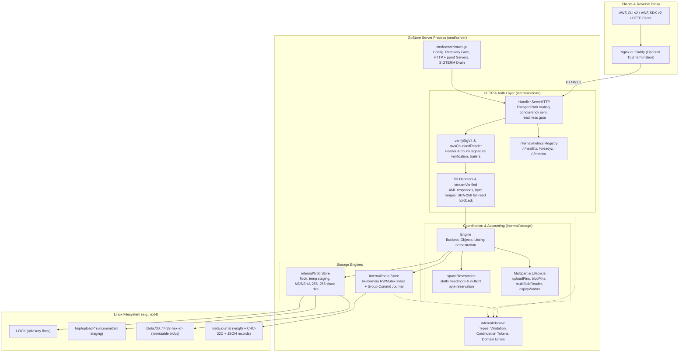

# GoStore: System Architecture & Code Walkthrough

This document explains the system architecture, component responsibilities, concurrency and durability guarantees, and package-by-package implementation of **GoStore**.

---

## 1. Project Overview & Design Philosophy

GoStore is a single-node, S3-compatible object storage service written in Go for Linux (`amd64` / `arm64`). It exposes path-style S3 HTTP endpoints (`/{bucket}/{key}`) protected by AWS Signature V4 authentication and persists objects durably to a local POSIX filesystem.

The design is built around four core invariants:

1. **Streaming I/O never holds metadata locks:** Request bodies stream to/from temporary or published files on disk without locking metadata structures or keeping transactions open during network transfers.
2. **Keys are data, never file paths:** S3 object keys (such as `../../etc/passwd` or UTF-8 names) only live in metadata records. On disk, blobs are stored under random 128-bit hexadecimal IDs.
3. **Commit-point linearizability:** An object becomes visible to readers only after its blob is `fsync`-ed, renamed into its shard directory, directory-synced, and its metadata record is appended and `fsync`-ed to `meta.journal`.
4. **Bounded resources:** Active HTTP data concurrency (`sem`), per-chunk socket idle timeouts, disk free-space reservations, and background expiry cleanup are bounded so overload or slow clients do not exhaust memory, file descriptors, or disk space.

---

## 2. High-Level System Architecture

---

## 3. On-Disk Storage Layout

Under `GOSTORE_DATA_DIR` (default `./data`):

| Path | Purpose | Lifecycle & Permissions |
|---|---|---|
| `LOCK` | Advisory `syscall.Flock` file (`LOCK_EX \| LOCK_NB`) | Held for server lifetime (`0600`); prevents two GoStore processes from sharing one data directory |
| `meta.journal` | Append-only metadata log (`GOSTORE-JOURNAL-1\n` header + CRC-32C records) | Replayed & compacted on startup (`0600`); updated only via group-commit append + `Sync()` |
| `tmp/upload-*` | Temporary upload staging files (`0600`) | Written during streaming uploads/assemblies, removed on failure or startup cleanup |
| `blobs/00..ff/<id>` | Immutable published blob files (`0600`, dirs `0700`) | 256 two-hex-char shard directories created up front so uploads never `mkdir` or sync parent dir trees |

---

## 4. Component & Code Breakdown

### 4.1 `cmd/server` & `internal/config` — Process Lifecycle & Configuration

- **[`internal/config/config.go`](../internal/config/config.go):**
  - `Config` holds typed server settings (`Addr`, `PprofAddr`, `DataDir`, `ShutdownTimeout`, `IdleTransferTimeout`, `MaxConcurrentRequests`, `MaxObjectSize`, `MaxMultipartSize`, `MinPartSize`, `MaxUploadParts`, `UploadExpiry`, `MinFreeSpace`, `ListPageSize`, `AccessKey`, `SecretKey`, `Region`).
  - `Load()` parses environment variables, enforces required credentials (`GOSTORE_ACCESS_KEY`, `GOSTORE_SECRET_KEY`), and rejects any non-loopback `GOSTORE_PPROF_ADDR` via `isLocalhostAddr`.
- **[`cmd/server/main.go`](../cmd/server/main.go):**
  - `main()` configures JSON structured logging (`slog.NewJSONHandler`) to stdout and calls `run()`.
  - `run()` binds `SIGINT` / `SIGTERM` via `signal.NotifyContext`.
  - `runServer()`:
    1. Opens storage synchronously via `storage.OpenWithOptions(...)` **before** opening the TCP listener so recovery finishes before traffic arrives.
    2. Registers `defer engine.Close()`, ensuring workers and `meta.journal` only close after all HTTP handlers finish.
    3. Builds `server.Handler` and optionally starts the separate loopback-only `pprof` server (`startPprof`).
    4. Configures `http.Server` with `ReadHeaderTimeout: 10s`, `IdleTimeout: 60s`, and a cancelable `BaseContext` (`baseCtx`).
    5. On `ctx.Done()`: flips `h.SetReady(false)` (immediately failing `/-/readyz` and rejecting new S3 requests with `503`), calls `srv.Shutdown(shutdownCtx)` up to `GOSTORE_SHUTDOWN_TIMEOUT`, cancels `baseCtx` + `srv.Close()` if the deadline expires, and blocks on `h.Wait()` before returning so `defer engine.Close()` runs safely.

---

### 4.2 `internal/domain` — Core Models, Validation & Tokens

Pure Go package with zero HTTP or filesystem dependencies:

- **[`internal/domain/types.go`](../internal/domain/types.go):** Defines `Bucket`, `Object` (carries `BlobID`, `Size`, `ETag`, `SHA256`, `ContentType`, `Metadata`, `ModifiedAt`), `Upload`, `Part`, `CompletedPart`, `CompletedUpload`, `ListPartsOptions/Result`, `ListOptions/Result`, and S3 default limits (`DefaultMaxKeys=1000`, `DefaultMaxPartSize=1 GiB`, `DefaultMaxMultipartObjectSize=5 GiB`, `DefaultMinPartSize=5 MiB`, `DefaultMaxUploadParts=10000`, `DefaultUploadExpiry=24h`).
- **[`internal/domain/errors.go`](../internal/domain/errors.go):** Sentinel domain errors (`ErrInvalidBucketName`, `ErrInvalidKey`, `ErrInvalidMetadata`, `ErrMetadataTooLarge`, `ErrInvalidToken`, `ErrInvalidArgument`, `ErrBucketExists`, `ErrBucketNotEmpty`, `ErrNoSuchBucket`, `ErrNoSuchKey`, `ErrNoSuchUpload`, `ErrInvalidPart`, `ErrInvalidOrder`, `ErrEntityTooSmall`, `ErrEntityTooLarge`, `ErrInsufficientStorage`).
- **[`internal/domain/validate.go`](../internal/domain/validate.go):**
  - `ValidateBucketName`: enforces S3 rules (3–63 chars, lowercase/digits/`-`/`.`, no `..`, not an IP address, no reserved prefixes/suffixes; `-` fails length < 3 so `/-/` can never collide with a bucket).
  - `ValidateKey`: checks non-empty, `<= 1024` UTF-8 bytes, valid UTF-8, and no NUL (`\x00`) bytes (XML cannot represent `\x00`). Allows strings like `../../etc/passwd` cleanly as literal key names.
  - `ValidateMetadata`: enforces lowercase HTTP token keys and printable ASCII values (`0x20..0x7e`), total combined size `<= 2048` bytes.
- **[`internal/domain/token.go`](../internal/domain/token.go):** `ListToken` (`Bucket`, `Prefix`, `Delimiter`, `After`) encoded as URL-safe unpadded Base64 JSON (`Encode` / `DecodeListToken`). Decoding binds the token strictly to matching `(Bucket, Prefix, Delimiter)` parameters so a token from one query cannot be used on another.

---

### 4.3 `internal/blob` — Streaming Immutable Blob Store (Linux)

- **[`internal/blob/store.go`](../internal/blob/store.go):**
  - `Open(root)` creates `root` (directory-syncing every newly created ancestor via `mkdirAllSynced`), acquires an exclusive non-blocking `flock` on `LOCK` (`ErrLocked` if another process holds it), creates `tmp/` and all 256 `blobs/00..ff` shard directories, and syncs `blobDir`, `root`, and `filepath.Dir(root)`.
  - `Put(ctx, r, opts)` implements steps 1–4 of the write protocol:
    1. Generates a 16-byte random hex `id` via `crypto/rand` (`newID`).
    2. Creates `tmp/upload-*` (`os.CreateTemp`, mode `0600`) with deferred cleanup (`Close` + `Remove` if not published).
    3. Streams `r` through one fixed `64 KiB` buffer (`copyStream`) into `io.MultiWriter(f, md5Hash, shaHash)`, checking `ctx.Err()` between reads, enforcing `opts.MaxSize`, and invoking `opts.OnWrite(written)` for live space accounting.
    4. Validates `WantSize`, `WantMD5`, and `WantSHA256` (`verify`).
    5. Calls `f.Sync()` and `f.Close()`, hits crash point `blob.before-rename`, atomically renames temp file to `blobs/<id[:2]>/<id>`, hits `blob.after-rename`, and calls `syncDir` on the shard directory.
  - `Open(id)` validates ID format (`validID` accepts strictly 32 lowercase hex chars, blocking traversal) and opens `blobs/<id[:2]>/<id>`. Because Linux keeps an unlinked inode readable through open descriptors, concurrent readers finish cleanly even if overwritten/deleted later.
  - `Delete(id)` unlinks `blobs/<id[:2]>/<id>` (succeeds if already absent).
- **[`internal/blob/recovery.go`](../internal/blob/recovery.go):** Startup-only helpers `RemoveTemp()` (clears `tmp/`), `IDs()` (walks `blobs/` for valid published blob IDs), and `Size(id)`.

---

### 4.4 `internal/meta` — In-Memory Index & Group-Commit CRC-32C Journal

- **[`internal/meta/journal.go`](../internal/meta/journal.go):**
  - **Record binary framing:** File begins with `"GOSTORE-JOURNAL-1\n"`, followed by records formatted as:
    - `4 bytes`: payload length (big-endian `uint32`)
    - `4 bytes`: CRC-32C (`Castagnoli`) of the 4-byte length
    - `4 bytes`: CRC-32C (`Castagnoli`) of the payload
    - `n bytes`: JSON payload (`record` carrying `op` and optional `bucket`, `object`, `upload`, `part`, `completed`)
  - Checksumming the length separately prevents a corrupted length from being mistaken for an unfinished tail record.
  - `replay(data, apply)` scans records sequentially: breaks cleanly on an incomplete header, all-zero trailing allocation, or incomplete payload at EOF; returns `ErrCorrupt` on bad header, invalid length CRC, oversized record (`> 64 KiB`), payload CRC mismatch, or invalid JSON.
  - `writeJournal(path, records)` writes a complete snapshot to `path.tmp`, `Sync`s, `Close`s, renames over `path`, and `syncDir`s.
- **[`internal/meta/store.go`](../internal/meta/store.go):**
  - `Store` keeps live state in memory protected by `mu sync.RWMutex` (`buckets`, `uploads`, `completions`). Each `bucketState` stores both `objects map[string]domain.Object` (O(1) point lookup) and `keys []string` sorted in UTF-8 byte order (`slices.BinarySearch` / `Insert` / `Delete`).
  - `Open(path, allowCreate)` loads `meta.journal` (`ErrMissing` if absent and `allowCreate=false`, e.g., when blobs already exist on disk), replays records, compacts atomically via `writeJournal` if `count > 2*len(live)+compactSlack` (`1000`), truncates & syncs away any discarded tail bytes if uncompacted, and opens `O_WRONLY|O_APPEND`.
  - `ListObjects(...)` holds `mu.RLock()`, seeks into `b.keys` via `startAt` binary search, iterates in UTF-8 order, and when `delimiter != ""` jumps past all keys sharing a common prefix using `nextPrefix(cp)` + binary search (avoiding full-bucket scans).
- **[`internal/meta/batch.go`](../internal/meta/batch.go):**
  - Implements **leader-follower group commit** (`submit`, `flushBatch`, `batchOverlay`):
    - Concurrent writers append `writeReq` closures to `pending` under `queueMu`. One active leader drains `pending`, runs `flushBatch` under `writeMu`, and hands off leadership (`close(nextLeader.becomeLeader)`) if new waiters arrived while syncing—returning its own result immediately instead of absorbing a second batch's latency.
    - Inside `flushBatch`, `batchOverlay` tracks per-batch bucket creates/deletes/count deltas, object edits, upload edits, and completion edits so conflicting ops in the same batch (e.g., two overwrites of the same key, or `PutObject` racing `DeleteBucket`) see exact sequential pre-state without leaking uncommitted mutations to `RLock` readers.
    - Failed pre-validations fail only their own `writeReq` without touching disk. Valid encoded records are concatenated into `batchBuf`, written in one `journal.Write(batchBuf)`, hit crash point `meta.after-write`, synced with **one** `journal.Sync()`, applied to in-memory state under `mu.Lock()`, and fanned out to each waiter's `done` channel.
    - On write or sync error, `s.failed` is latched with `ErrCommitUnknown`, refusing all further mutations until restart.
- **[`internal/meta/multipart.go`](../internal/meta/multipart.go):** Implements `CreateUpload`, `HasUpload`, `PutPart`, `UploadSnapshot` (runs caller `pinFn` inside `mu.RLock()` so part blobs are pinned atomically before concurrent aborts/replacements can delete them), `ListParts`, `AbortUpload`, `Completion`, `CompleteUpload`, `ExpireUploads` (aborts up to 100 inactive uploads and purges expired 24h completion records per run), and `AllPartBlobIDs`.

---

### 4.5 `internal/storage` — Storage Engine & Resource Coordination

- **[`internal/storage/engine.go`](../internal/storage/engine.go):**
  - `OpenWithOptions(root, opts)` coordinates startup recovery: opens `blob.Store`, lists published `blob.IDs()`, opens `meta.Store` (disallowing empty journal creation if orphaned blobs exist), removes `tmp/` leftovers, verifies every metadata object's blob exists with matching `Size` (`Report.Damaged`), marks active part blobs as used, deletes all unreferenced orphan blobs (`Report.OrphansRemoved`), and starts the background expiry ticker (`ExpiryInterval`, default `1m`) unless disabled.
  - `PutObject(ctx, req, body)` validates key & metadata, checks bucket existence early, reserves disk space (`reserveSpace`), calls `blobs.Put`, hits `storage.before-commit`, commits to `meta.Store`, hits `storage.after-commit`, and unlinks any replaced old blob (deferring deletion if pinned). On metadata failure (unless `ErrCommitUnknown`), deletes the newly written uncommitted blob.
  - `HeadObject` and `OpenObject` share `lookupObject`, which loops if `blobs.Size`/`Open` hits `ErrNotFound` right as a concurrent overwrite/delete unlinked the previous blob, preventing spurious `404`/`500` races during concurrent updates (`TestLookupRetriesWhenBlobRemoved`). `checkSize` verifies actual file size on `OpenObject` via `Seek(0, SeekEnd)` + `Seek(0, SeekStart)`.
- **[`internal/storage/space.go`](../internal/storage/space.go):** `reserveSpace`, `consume`, and `release` track `reservedBytes` under `spaceMu` against `syscall.Statfs` available bytes minus `MinFreeSpace` (`1 GiB` default). Fixed-size requests reserve up front; unknown-size streams (`checkDynamic=true`) re-check headroom per write chunk.
- **[`internal/storage/multipart.go`](../internal/storage/multipart.go):**
  - Implements `InitiateMultipartUpload`, `UploadPart`, `ListParts`, `AbortMultipartUpload`, `CompleteMultipartUpload`, and `ExpireUploads`.
  - Uses `pinMu` (`uploadPins`, `blobPins`, `pendingDelete`) so:
    1. In-flight `UploadPart`/`ListParts`/`CompleteMultipartUpload` requests cannot be expired mid-flight by `ExpireUploads`.
    2. `CompleteMultipartUpload` pins every part blob while reading them sequentially through `multiBlobReader` (keeping at most 1 part FD open at a time) into `blobs.Put`, then commits `opCompleteUpload` (which re-verifies each part's `BlobID` didn't change mid-assembly) before unpinning and executing deferred deletions.
  - Computes multipart ETag as `<md5(concat(binary_part_md5s))>-<part_count>` and caches `CompletedUpload` for 24h (`CompletionRetention`) so retried completion requests are idempotent.

---

### 4.6 `internal/server` — HTTP, S3 Protocol, SigV4 & Integrity

- **[`internal/server/server.go`](../internal/server/server.go):**
  - `Handler.ServeHTTP` assigns `X-Amz-Request-Id`, reads `r.URL.EscapedPath()` directly (so Go's HTTP mux never cleans `..` or `//`), handles operational paths `/-/healthz`, `/-/readyz`, `/-/metrics` without semaphore limits, checks readiness (`503 ServiceUnavailable` with `Connection: close` during shutdown), enforces the non-blocking concurrency gate `sem` (`503 SlowDown` with `Retry-After: 1` when full), tracks active requests (`WaitGroup` + `metrics.IncActive/DecActive`), verifies SigV4 (`verifySigV4` unless `AllowUnauthenticated`), and routes to `handleService`, `handleBucket`, or `handleObject`.
- **[`internal/server/sigv4.go`](../internal/server/sigv4.go):**
  - `verifySigV4` parses `Authorization` (`AWS4-HMAC-SHA256`), validates credential date, region, service (`s3`), request timestamp skew (`+-15m` default), canonical `SignedHeaders` (requiring lowercase sorted headers containing `host`, date, and `x-amz-content-sha256`), `canonicalURI` (without `path.Clean` normalization for S3), `canonicalQueryString`, derives the daily signing key (`AWS4` -> date -> region -> service -> `aws4_request`), and compares signatures with `hmac.Equal` (constant-time). Supports `signed` SHA-256 hex, `UNSIGNED-PAYLOAD`, and three `STREAMING-*` chunked modes.
- **[`internal/server/chunked.go`](../internal/server/chunked.go):**
  - `awsChunkedReader` incrementally decodes `aws-chunked` frames (`size;chunk-signature=...` + `\r\n` + data + `\r\n`), verifies chained HMAC-SHA256 chunk signatures when signed, tracks streaming trailers (`checksumTracker` supporting `CRC32`, `CRC32C`, `SHA1`, `SHA256`, `CRC64NVME`), and verifies trailer digests after the terminating `0`-byte chunk.
  - `headerChecksumReader` verifies non-chunked `x-amz-checksum-*` headers at EOF.
- **[`internal/server/s3.go`](../internal/server/s3.go), [`range.go`](../internal/server/range.go), [`xml.go`](../internal/server/xml.go):**
  - `prepareUploadBody` parses `Content-MD5`, wraps `r.Body` in `deadlineReader` (refreshing read deadlines per chunk), sets up `awsChunkedReader` or `headerChecksumReader` + `WantSize`/`WantSHA256`.
  - `handleGetOrHeadObject` handles `Range` (`parseByteRange` supporting `bytes=start-end`, `bytes=start-`, `bytes=-suffix`; rejects multi-range with `416`), `HEAD`, and full `GET`.
  - `streamVerified` reads `64 KiB` chunks (`curr`/`prev`), computes SHA-256 on the fly, and **holds back `prev`** until EOF succeeds and `gotSHA == obj.SHA256`. If corruption is detected after headers were sent, `abortConnection` hijacks and closes the raw TCP socket (`panic(http.ErrAbortHandler)` fallback) so clients never observe a complete `200 OK` body on corrupted data.
  - `writeMappedError` translates domain, blob, chunk, and storage errors into standard S3 XML `Error` responses (`NoSuchBucket`, `NoSuchKey`, `BucketNotEmpty`, `EntityTooLarge`, `InsufficientStorage`, `InvalidRange`, `SignatureDoesNotMatch`, `BadDigest`, `InternalError`, `NotImplemented`, etc.).

---

### 4.7 `internal/metrics`, `internal/crashpoint` & `cmd/bench`

- **[`internal/metrics/metrics.go`](../internal/metrics/metrics.go):** Thread-safe Prometheus registry tracking `gostore_ready`, `gostore_active_requests`, `gostore_request_bytes_total{direction}`, `gostore_requests_total{op,status}`, `gostore_errors_total{op,code}`, and `gostore_request_duration_seconds` histograms without putting user object keys into labels (avoiding unbounded cardinality).
- **[`internal/crashpoint/crashpoint.go`](../internal/crashpoint/crashpoint.go):** Zero-cost no-op hook in production (`Hook == nil`); `TestCrashRecovery` populates `Hook` in child subprocesses to trigger `SIGKILL` at 6 deterministic write stages (`mid-stream`, `blob.before-rename`, `blob.after-rename`, `storage.before-commit`, `meta.after-write`, `storage.after-commit`).
- **[`cmd/bench/main.go`](../cmd/bench/main.go):** Self-contained S3 load generator that compiles/launches `cmd/server`, manages a dedicated data directory, captures `/proc/<pid>/stat`, `/proc/<pid>/status`, `/proc/<pid>/fd`, and optional `pprof` CPU/heap profiles, and prints exact latency percentiles (`p50`, `p95`, `p99`), throughput (`Ops/s`, `MiB/s`), CPU%, RSS, FDs, and disk usage.

---

## 5. End-to-End Request Lifecycles

### 5.1 `PutObject` Write Path & Concurrent Group Commit

1. HTTP request arrives at `Handler.ServeHTTP` -> acquires concurrency slot in `h.sem` -> `verifySigV4` validates signature & classifies payload mode.
2. `handlePutObject` wraps body in `deadlineReader` + `awsChunkedReader`/`headerChecksumReader` and calls `Engine.PutObject`.
3. `Engine.PutObject` validates key & metadata, checks bucket exists, reserves disk space (`reserveSpace`), and streams body into `blob.Store.Put` (`tmp/upload-*` -> verify size/MD5/SHA-256 -> `f.Sync()` -> `f.Close()` -> `os.Rename` to `blobs/xx/<id>` -> `syncDir`).
4. `meta.Store.PutObject` submits a write request to the group-commit queue (`batch.go`). One leader coalesces all queued concurrent requests, evaluates each sequentially via `batchOverlay`, writes all valid records in one `journal.Write`, executes one `journal.Sync()` (**the commit point**), updates `Store.buckets` under `mu.Lock()`, and notifies all callers.
5. `Engine.PutObject` deletes any replaced old blob (or queues `pendingDelete` if pinned) and HTTP responds `200 OK` with quoted MD5 `ETag`.

### 5.2 Full `GetObject` Integrity Path

1. HTTP `GET /{bucket}/{key}` passes `sem` + `verifySigV4` and calls `Engine.OpenObject`.
2. `lookupObject` looks up metadata (`meta.Store.Object`), opens `blobs/<id[:2]>/<id>`, and verifies file length (`checkSize`); retries if the blob was just replaced and unlinked between lookup and open.
3. `streamVerified` buffers one `64 KiB` lookahead chunk (`prev`), streams earlier chunks while updating SHA-256, and transmits the final chunk **only** if byte length and `SHA-256` match metadata at EOF—otherwise hijacks and closes the socket immediately.

---

## 6. Build, Packaging & Automation

| File | Purpose |
|---|---|
| [`Makefile`](../Makefile) | Shortcuts: `make run`, `make test`, `make check` (`gofmt`, `go vet`, `go test -race ./...`), `make bench` |
| [`Dockerfile`](../Dockerfile) | Multi-stage build (`golang:1.27-alpine` builder -> non-root UID/GID `10001` on `alpine:3.21` with `HEALTHCHECK` on `/-/readyz`) |
| [`docker-compose.yml`](../docker-compose.yml) | Runs GoStore on `127.0.0.1:9000`, mounts persistent `gostore_data` volume at `/data`, sets `stop_grace_period: 35s` |
| [`scripts/demo.sh`](../scripts/demo.sh) | Interactive/automated reviewer demo including restart persistence check |
| [`scripts/aws_cli_check.sh`](../scripts/aws_cli_check.sh) | AWS CLI v2 single-part, multipart, listing, download, and delete integration test |
| [`scripts/container_check.sh`](../scripts/container_check.sh) | Docker Compose build, metrics, `--force-recreate` persistence, and shutdown-timing check |
| [`.github/workflows/ci.yml`](../.github/workflows/ci.yml) | CI pipeline running `gofmt`, `go vet`, `staticcheck`, `govulncheck`, `go test -race ./...`, AWS CLI v2 check, and container check |
